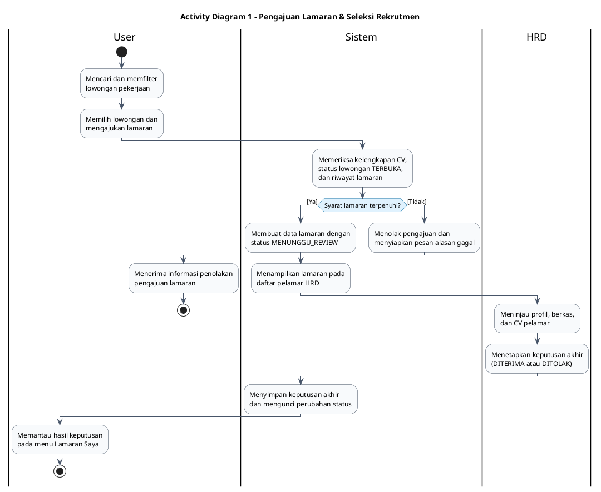
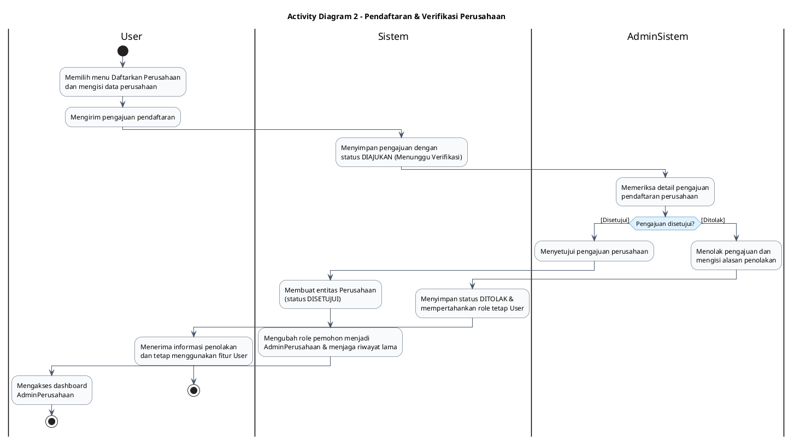
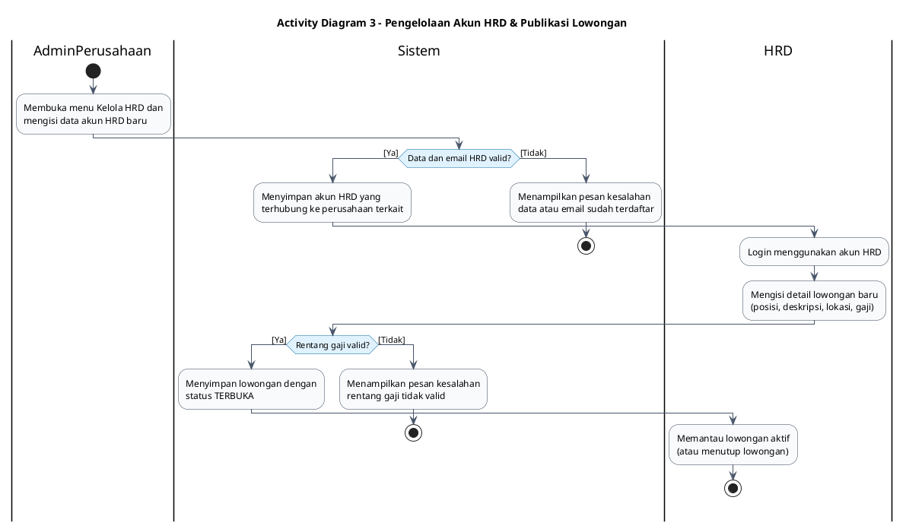

# GET A JOB - Activity Diagram

## Deskripsi & Standar Pemodelan

**Activity Diagram** ini memodelkan alur kerja (*workflow*) proses bisnis utama pada sistem **GET A JOB**. Rancangan disusun berdasarkan **Dokumen Keputusan Fitur Final**, **Use Case Diagram**, **Class Diagram**, dan **Sequence Diagram**, serta mengikuti kaidah pemodelan UML pada **Sub-CPMK 4 dan Sub-CPMK 5**:

1. **Swimlane (Partisi Tanggung Jawab):** Memisahkan aktivitas berdasarkan aktor (`User`, `AdminPerusahaan`, `HRD`, `AdminSistem`) dan `Sistem` (`services/` & `models/`).
2. **Initial & Final Node:** Setiap alur diawali dengan satu titik mulai (*Initial Node*) dan ditutup secara tuntas dengan titik akhir (*Final Node*) tanpa ada aktivitas yang menggantung.
3. **Decision Node & Guard Condition:** Setiap percabangan keputusan menggunakan simbol *diamond* yang dilengkapi label kondisi (`[Ya]` / `[Tidak]` atau `[Disetujui]` / `[Ditolak]`).
4. **Kesesuaian Aturan Bisnis Final:** Menggunakan mekanisme seleksi lamaran 3 tahap (`MENUNGGU_REVIEW`, `DITERIMA`, `DITOLAK`) serta alur promosi peran dari `User` menjadi `AdminPerusahaan` melalui verifikasi `AdminSistem`.

---

## Activity Diagram 1: Pengajuan Lamaran & Seleksi Rekrutmen

### Penjelasan Alur

Diagram ini menggambarkan siklus rekrutmen mulai dari pencari kerja mengajukan lamaran hingga HRD menetapkan keputusan akhir:

1. **Pencarian & Pengajuan (`User`):** `User` mencari serta memfilter lowongan berdasarkan kriteria yang diinginkan, lalu memilih lowongan dan mengajukan lamaran.
2. **Validasi Syarat Lamaran (`Sistem`):** `Sistem` memeriksa tiga aturan bisnis secara berurutan:
   * Kelengkapan berkas CV pada profil `User` (**BR-11**).
   * Status lowongan masih `TERBUKA` (**BR-10**).
   * `User` belum pernah melamar pada lowongan yang sama (**BR-12**).
3. **Percabangan Validasi (`[Tidak]` vs `[Ya]`):**
   * Jika **tidak memenuhi syarat (`[Tidak]`)**, `Sistem` menolak pengajuan, menampilkan pesan alasan kegagalan kepada `User`, dan proses berakhir.
   * Jika **memenuhi syarat (`[Ya]`)**, `Sistem` membuat entitas `Lamaran` dengan status awal `MENUNGGU_REVIEW` (**BR-13**) dan menampilkannya di daftar pelamar perusahaan terkait.
4. **Evaluasi & Keputusan Akhir (`HRD` & `Sistem`):** `HRD` meninjau profil, berkas, dan CV pelamar, lalu menetapkan keputusan akhir berupa `DITERIMA` atau `DITOLAK` (**BR-14**). `Sistem` menyimpan keputusan tersebut dan mengunci status akhir agar tidak dapat diubah kembali (**BR-15**).
5. **Pemantauan Hasil (`User`):** `User` melihat hasil akhir lamaran melalui menu *Lamaran Saya* (**BR-16**).

### Kode PlantUML (Activity Diagram 1)

Salin kode berikut ke **draw.io** melalui menu **Arrange > Insert > Advanced > PlantUML**:

---

## Activity Diagram 2: Pendaftaran Perusahaan & Verifikasi oleh AdminSistem

### Penjelasan Alur

Diagram ini menjelaskan alur perubahan peran (*role*) dari `User` menjadi `AdminPerusahaan` setelah mendapat persetujuan dari `AdminSistem`:

1. **Pengajuan Perusahaan (`User`):** Pengguna yang telah terdaftar sebagai `User` membuka menu *Daftarkan Perusahaan*, mengisi formulir profil perusahaan, dan mengirimkan permohonan (**BR-02**).
2. **Pencatatan Pengajuan (`Sistem`):** `Sistem` menyimpan data pengajuan ke entitas `PengajuanPerusahaan` dengan status awal `DIAJUKAN`.
3. **Pemeriksaan & Keputusan (`AdminSistem`):** `AdminSistem` memeriksa keabsahan data pengajuan perusahaan yang masuk (**BR-03**) dan menentukan hasil verifikasi:
   * **Jika `[Disetujui]`:** `Sistem` membentuk entitas `Perusahaan` baru berstatus `DISETUJUI`, mengubah *role* akun pemohon dari `User` menjadi `AdminPerusahaan` (**BR-04, BR-05**), tetap mempertahankan riwayat lamaran sebelumnya (**BR-17**), dan memberikan akses ke dashboard `AdminPerusahaan`.
   * **Jika `[Ditolak]`:** `AdminSistem` mencatat alasan penolakan, `Sistem` mengubah status pengajuan menjadi `DITOLAK`, dan akun pemohon tetap berstatus `User` sehingga masih dapat melamar pekerjaan.

### Kode PlantUML (Activity Diagram 2)

Salin kode berikut ke **draw.io** melalui menu **Arrange > Insert > Advanced > PlantUML**:

---

## Activity Diagram 3: Pengelolaan Akun HRD & Publikasi Lowongan

### Penjelasan Alur

Diagram ini memodelkan hubungan kerja antara `AdminPerusahaan` dan `HRD` dalam menyiapkan rekrutmen perusahaan:

1. **Pembuatan Akun HRD (`AdminPerusahaan`):** `AdminPerusahaan` membuka menu *Kelola HRD* dan memasukkan identitas serta kredensial awal untuk akun `HRD` baru (**BR-07**).
2. **Validasi & Penyimpanan Akun (`Sistem`):** `Sistem` memvalidasi keunikan email dan format data. Jika valid (`[Ya]`), akun `HRD` disimpan dan otomatis terikat pada `Perusahaan` milik pembuat akun (**BR-06**).
3. **Input Lowongan Pekerjaan (`HRD`):** `HRD` masuk menggunakan akun yang telah dibuat, lalu mengisi detail lowongan baru (posisi, deskripsi, persyaratan, lokasi, dan rentang gaji).
4. **Validasi Gaji & Publikasi (`Sistem` & `HRD`):** `Sistem` memastikan rentang gaji valid ($gaji\_min \ge 0$ dan $gaji\_max \ge gaji\_min$). Jika valid (`[Ya]`), lowongan disimpan dengan status `TERBUKA` (**BR-09, BR-10**) sehingga dapat dilihat dan dilamar oleh `User`.

### Kode PlantUML (Activity Diagram 3)

Salin kode berikut ke **draw.io** melalui menu **Arrange > Insert > Advanced > PlantUML**:

---

## Pemetaan Activity Diagram ke Implementasi Kode (Sub-CPMK 5)

Seluruh elemen pada ketiga diagram di atas dipetakan langsung ke struktur modular proyek:

| Elemen Activity Diagram | Translasi pada Struktur Kode Python |
| :--- | :--- |
| **Swimlane (`User`, `AdminPerusahaan`, `HRD`, `AdminSistem`)** | Pemisahan menu navigasi dan hak akses pada `main.py` serta kelas aktor di `models/` |
| **Swimlane (`Sistem`)** | Orkestrasi logika pada `services/` (`lamaran_service.py`, `verifikasi_service.py`, `lowongan_service.py`) |
| **Decision Node (`[Ya]` / `[Tidak]`)** | Struktur kontrol percabangan `if ... else` pada lapisan `services/` dan validasi *setter* di `models/` |
| **Action Simpan / Perbarui Data** | Pemanggilan method `*_dao_impl.py` (`LamaranDAOImpl`, `PerusahaanDAOImpl`, `LowonganDAOImpl`, `PenggunaDAOImpl`) |