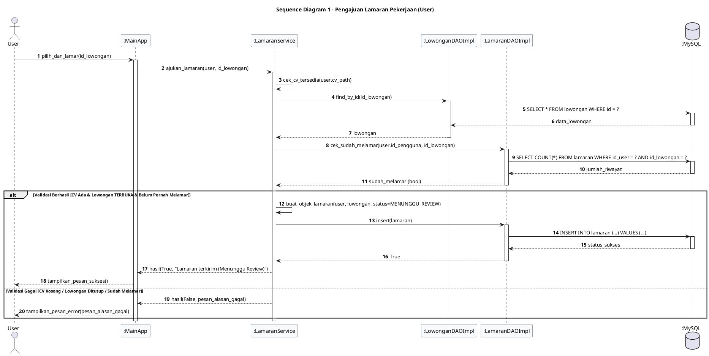
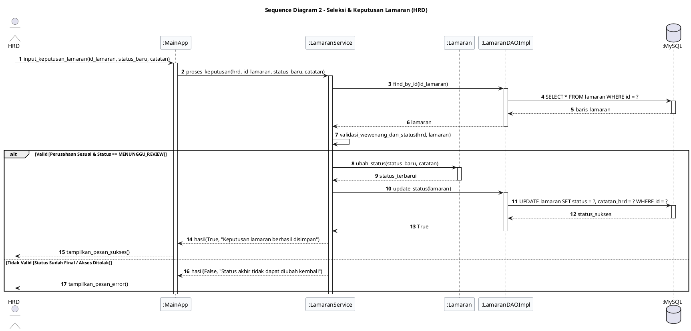
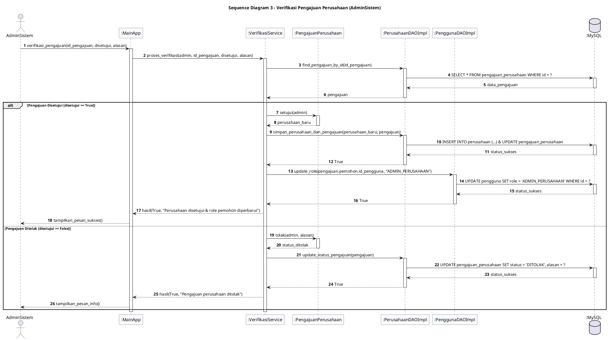

# GET A JOB - Sequence Diagram

## Deskripsi & Prinsip Desain

**Sequence Diagram** ini memodelkan interaksi dinamis antar-objek berdasarkan urutan waktu (*time sequence*) pada sistem **GET A JOB**. Seluruh alur disusun mengikuti arsitektur berlapis (*Layered Architecture*) dan pola *Data Access Object* (DAO) yang telah ditetapkan pada rancangan sistem:

1. **Aktor (`User`, `HRD`, `AdminSistem`):** Pihak eksternal yang memicu interaksi dengan aplikasi.
2. **Presentation Layer (`:MainApp`):** Titik masuk aplikasi (`main.py`) yang menerima input pengguna dan menampilkan hasil ke layar.
3. **Service Layer (`:LamaranService`, `:VerifikasiService`):** Lapisan logika bisnis (`services/`) yang mengorkestrasi validasi aturan bisnis (BR-01 s.d. BR-17).
4. **Domain Model Layer (`:Lamaran`, `:PengajuanPerusahaan`):** Entitas OOP (`models/`) yang menjaga enkapsulasi dan integritas perubahan status objek.
5. **DAO Implementation Layer (`:*DAOImpl`):** Implementasi akses data (`dao/*_dao_impl.py`) yang menjalankan *query* SQL ke database.
6. **Database (`:MySQL`):** Penyimpanan data relasional MySQL.

> **Standar Notasi (Sub-CPMK 4):** Setiap skenario menggunakan *lifeline* berstandar UML, *activation bar* untuk menandai masa aktif eksekusi proses, penomoran pesan berurutan dari atas ke bawah, serta *combined fragment* **`alt`** untuk memodelkan percabangan kondisi berhasil dan gagal secara jelas dan mudah dibaca.

---

## Skenario 1: Pengajuan Lamaran Pekerjaan oleh User

### Alur Singkat
1. **User** memilih lowongan yang diminati dan menekan menu pengiriman lamaran melalui `:MainApp`.
2. `:MainApp` meneruskan permintaan ke `:LamaranService`.
3. `:LamaranService` menjalankan 3 pemeriksaan berurutan sesuai aturan bisnis:
   * Kelengkapan berkas CV pada profil `User` (**BR-11**).
   * Status lowongan masih `TERBUKA` melalui `:LowonganDAOImpl` (**BR-10**).
   * User belum pernah melamar pada lowongan yang sama melalui `:LamaranDAOImpl` (**BR-12**).
4. Jika seluruh validasi terpenuhi (`[Validasi Berhasil]`), sistem membuat objek `Lamaran` dengan status awal `MENUNGGU_REVIEW` (**BR-13**) dan menyimpannya ke `:MySQL`. Jika salah satu syarat tidak terpenuhi (`[Validasi Gagal]`), sistem menolak pengajuan dan menampilkan pesan kegagalan.

### Kode PlantUML (Skenario 1)

Salin kode berikut ke **draw.io** melalui menu **Arrange > Insert > Advanced > PlantUML**:

---

## Skenario 2: Seleksi & Keputusan Status Lamaran oleh HRD

### Alur Singkat
1. **HRD** meninjau detail lamaran dan CV pelamar, lalu menetapkan keputusan akhir (`DITERIMA` atau `DITOLAK`) beserta catatan evaluasi melalui `:MainApp`.
2. `:MainApp` memanggil `:LamaranService` untuk memproses keputusan tersebut.
3. `:LamaranService` mengambil objek `Lamaran` dari database melalui `:LamaranDAOImpl` dan memverifikasi bahwa lowongan tersebut memang milik perusahaan tempat HRD bekerja (**BR-08**) serta status lamaran masih `MENUNGGU_REVIEW`.
4. Jika valid (`[Status Masih MENUNGGU_REVIEW]`), service memanggil *method* terenkapsulasi `ubah_status()` pada entitas `:Lamaran`, lalu memperbarui data di `:MySQL` (**BR-14**).
5. Jika status lamaran sudah final (`DITERIMA` atau `DITOLAK`), sistem menolak perubahan karena keputusan akhir tidak dapat diubah kembali (**BR-15**).

### Kode PlantUML (Skenario 2)

Salin kode berikut ke **draw.io** melalui menu **Arrange > Insert > Advanced > PlantUML**:

---

## Skenario 3: Verifikasi Pengajuan Perusahaan oleh AdminSistem

### Alur Singkat
1. **AdminSistem** memeriksa detail berkas pengajuan pendaftaran perusahaan yang masuk dan menentukan keputusan (`disetujui = True` atau `False`) melalui `:MainApp`.
2. `:MainApp` meneruskan keputusan ke `:VerifikasiService`.
3. `:VerifikasiService` mengambil objek `PengajuanPerusahaan` melalui `:PerusahaanDAOImpl`.
4. Jika disetujui (`[Pengajuan Disetujui]`):
   * Entitas `:PengajuanPerusahaan` mengeksekusi `setujui(admin_sistem)` yang menghasilkan objek entitas `Perusahaan` baru.
   * `:PerusahaanDAOImpl` menyimpan data `Perusahaan` baru dan mengubah status pengajuan menjadi `DISETUJUI` di `:MySQL`.
   * `:PenggunaDAOImpl` memperbarui *role* akun pemohon dari `User` menjadi `AdminPerusahaan` (**BR-03, BR-04, BR-05**) tanpa menghapus riwayat lamaran sebelumnya (**BR-17**).
5. Jika ditolak (`[Pengajuan Ditolak]`):
   * Entitas `:PengajuanPerusahaan` mengeksekusi `tolak(admin_sistem, alasan)` dan menyimpan status `DITOLAK` ke `:MySQL` (akun pemohon tetap berstatus `User`).

### Kode PlantUML (Skenario 3)

Salin kode berikut ke **draw.io** melalui menu **Arrange > Insert > Advanced > PlantUML**:

